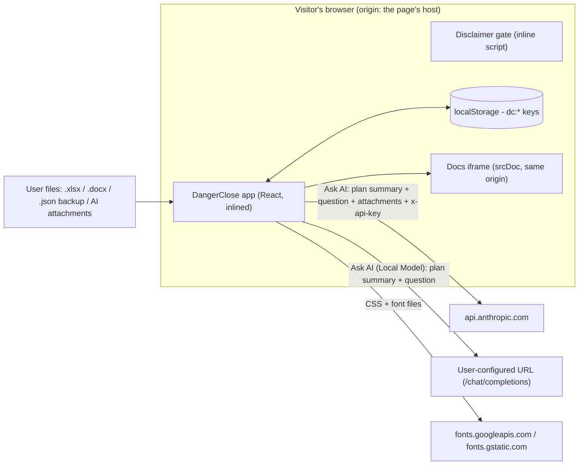

# Security

Danger Close is a single-file, client-side web app. It has no server, no accounts and no backend database. This document covers how to report a vulnerability, what the app trusts and stores, where data can leave the browser, the findings from the most recent security review, and how to harden your own copy.

- [Reporting a vulnerability](#reporting-a-vulnerability)
- [Architecture and trust boundaries](#architecture-and-trust-boundaries)
- [What is stored, and where](#what-is-stored-and-where)
- [Where data can leave the browser](#where-data-can-leave-the-browser)
- [Existing controls](#existing-controls)
- [Security review — v6.48 (2026-11-10)](#security-review--v648-2026-11-10)
- [Hardening guidance for users](#hardening-guidance-for-users)
- [Maintainer checklist](#maintainer-checklist)

---

## Reporting a vulnerability

**Do not open a public issue for a security problem.** The issue tracker and Discussions are public.

Report privately with GitHub's **Security → Report a vulnerability** (private vulnerability reporting) on this repository. Include the affected version (shown in the app footer and in `CHANGELOG.md`), steps to reproduce, and the impact you expect. Do not include real financial figures or a real API key; use the built-in Example Data.

This is a hobby project with no support commitment. Reports are read, but there is no guaranteed response time.

**Supported versions:** only the current `index.html` on `main` (the published build). Older builds are frozen and do not get fixes.

---

## Architecture and trust boundaries

| Component | Source | Notes |
|---|---|---|
| `index.html` (repo root) | Build output of `src/` via Vite + `vite-plugin-singlefile` | The published artifact. All JS and CSS are inlined. |
| Disclaimer gate | Inline `<script>` in [src/index.html](src/index.html) | Runs before React. Stores `dc:disclaimer_ack_v1` in `localStorage`. Not a security control. |
| Storage shim and fetch wrapper | [src/main.jsx](src/main.jsx) | Backs `window.storage` with `localStorage` under the `dc:` prefix. Rewrites keyless `https://api.anthropic.com` requests to same-origin `/anthropic`. |
| Application | [src/DangerClose.jsx](src/DangerClose.jsx) | All parsing, simulation, storage and AI calls. |
| Runtime dependencies | `react`, `react-dom`, `d3`, `xlsx`, `mammoth` (pinned by `package-lock.json`) | Bundled into `index.html`. `xlsx` and `mammoth` parse untrusted user files. |

**Trust assumptions**

- The visitor trusts the page's origin. Anything else served from that origin can read everything the app stores (see [F-2](#f-2-shared-origin-on-github-pages-exposes-stored-data-and-the-api-key)).
- Uploaded files (spreadsheets, Word documents, backups, AI attachments) are **untrusted input**. A backup shared by someone else is untrusted too.
- Text returned by an AI model is untrusted. The app renders it as React text (`{m.text}`), never as HTML.
- The app decides whether it is running inside claude.ai by hostname (`IS_CLAUDE_ARTIFACT`, [DangerClose.jsx](src/DangerClose.jsx)). On claude.ai the platform authenticates the AI call and the key panel is hidden. Anywhere else (any other host, or `file://`) the app uses bring-your-own-key mode. If the host cannot be determined, it treats itself as the artifact and hides the key panel.

---

## What is stored, and where

Everything is stored in the browser's `localStorage` for the page's origin, under the `dc:` prefix. Nothing is encrypted. The keys are defined in `STORAGE_KEYS` in [DangerClose.jsx](src/DangerClose.jsx).

| Key (after `dc:`) | Contents | Sensitivity | In backup export? | Removed by "delete everything"? |
|---|---|---|---|---|
| `danger_close:api_key_v1` | Anthropic API key (BYOK) | **Secret** | No | Yes |
| `danger_close:portfolio_v1` | Full plan: balances, holdings, income, birth dates, names | **High (PII / financial)** | Yes | Yes |
| `danger_close:expenses_v1` | Expense table | High | Yes | Yes |
| `danger_close:master_prompt_v1` | AI context / master prompt text | High | Yes (as `masterPrompt`) | Yes |
| `danger_close:checklist_v1` | Estate checklist: notes and third-party contacts | High | Yes | Yes |
| `danger_close:mydata_draft_v1` | Unsaved My Data form draft | High | No | Yes |
| `danger_close:local_llm_v1` | Local Model `{url, model}` | Low | No | Yes |
| `danger_close:meta_v1`, `skin_v1`, `ui_scale_v1`, `offline_v1`, `simple_v1`, `ss_cut_v1`, `scenario_v1`, `aca_regime_v1` | Preferences | Low | `skin` only | Yes |
| `disclaimer_ack_v1` | Disclaimer acknowledged | None | No | No (written by the gate, not the app) |

**Backup files** (`*.json` from Export) contain the full plan, expenses, AI context and checklist as **plain-text JSON**. They never contain the API key or the Local Model setting. Treat a backup like a bank statement. The repository `.gitignore` excludes `*[Bb]ackup*.json`, `my-data*.json`, `my_data*.json`, `*_Local.html`, `*_Private.*` and `.env*` so personal files are not committed by accident.

---

## Where data can leave the browser

| Destination | When | What is sent |
|---|---|---|
| `api.anthropic.com` | You press Ask AI with a saved key (self-hosted), or on claude.ai | Ground rules, the AI context / master prompt, a summary of the live plan and results, the last 12 conversation turns, attachments (images, PDFs and text, up to 8 files of 5 MB each), and your question. The key is sent as the `x-api-key` header together with `anthropic-dangerous-direct-browser-access: true`. |
| The Local Model URL you enter | You press Ask AI with a Local Model set | The same text context and conversation, plus text attachments. Images and PDFs are skipped. No API key is sent. |
| Same-origin `/anthropic` | Only if a keyless Anthropic request is made outside claude.ai. Since v5.70 the app refuses to send in that case (`_aiNoRoute`), so this path should not be reached. | Would be the full request. |
| `fonts.googleapis.com`, `fonts.gstatic.com` | Every page load, and when the Docs tab opens | Your IP address, user agent and referrer. No plan data. |

**Offline Mode** stops all Ask AI requests before anything is built. It does not block the Google Fonts requests.

---

## Existing controls

These are already in the code and were confirmed during the review:

- **No credentials in source, build or backups.** There is a permanent rule in the header of `DangerClose.jsx`, the key is excluded from export, and `.gitignore` covers `.env*`, `*.key`, `*.pem` and `secrets.json`. A `gitleaks` scan of all 1,372 commits found no secrets. The only `sk-ant-…` strings in history are obvious test placeholders such as `sk-ant-T36-00000000` in `qa/`.
- **Key scoping.** The key is attached only to requests to `https://api.anthropic.com/v1/messages`. It is never attached on claude.ai, and the key panel is hidden there.
- **No route, nothing sent** (v5.70, `_aiNoRoute`). Without a key or a Local Model, Ask AI refuses before it builds a request. This closed a leak where the plan context went to the page's own host.
- **No HTML injection sinks for untrusted data.** There is no `dangerouslySetInnerHTML`, `innerHTML`, `eval` or `new Function` in app code. AI output, error text from servers, file names and plan fields are all rendered as React text.
- **Import hardening** (v5.72). Backups are capped at 5 MB and 500 rows per list, parsed with `JSON.parse`, and checked for shape (`validateLoadedPlan`). A failed import rolls back to the previous plan.
- **AI attachment limits.** 5 MB per file, 8 files, and inlined text is capped at 100,000 characters.
- **Export filename sanitising.** Path and reserved characters are removed from the chosen filename.
- **Wipe covers secrets.** "Delete everything" removes the API key, the draft and every `STORAGE_KEYS` entry.

---

## Security review — v6.48 (2026-11-10)

**Scope:** `src/main.jsx`, `src/index.html`, `src/DangerClose.jsx` (storage, import, file parsing, Ask AI, Docs tab), `vite.config.js`, `package.json` / `package-lock.json`, the built `index.html` (spot-checked against the source), `.gitignore`, `.github/`, and the full git history (secret scan).

**Method:** manual code review, pattern search for injection sinks and storage and network calls, `gitleaks detect` over all history, and a dependency review against published advisories. `npm audit` could not reach the registry from the review machine because TLS is intercepted there, so the dependency findings below come from the pinned versions in `package-lock.json` and known advisories. Re-run `npm audit` from a normal network to confirm.

**Not in scope:** the statistical and tax correctness of the engines (see `METHODOLOGY.md` and `REVIEWING.md`), and the `qa/` and `validation/` suites. Those run locally on test fixtures and are not shipped.

### Summary

| ID | Finding | Severity | Status |
|---|---|---|---|
| F-1 | `xlsx@0.18.5` has known prototype-pollution and ReDoS advisories and parses untrusted uploads | **Medium** | Fixed (on fork `main`: upgraded to SheetJS CDN 0.20.3) |
| F-2 | Shared origin on GitHub Pages exposes stored data and the API key | **Medium** | Fixed (isolated dedicated origin configured: `https://dangerclose.le.org`) |
| F-3 | API key and plan stored unencrypted in `localStorage` | **Medium** | Fixed (on fork `main`: session-only toggle added, persistent storage opt-in) |
| F-4 | In-app guidance recommends `OLLAMA_ORIGINS="*"` | **Medium** | Fixed (on fork `main`) |
| F-5 | Local Model URL is not restricted to the local machine or to HTTPS | **Low–Medium** | Fixed (on fork `main`: loopback only) |
| F-6 | No Content-Security-Policy | **Low** | Fixed (on fork `main`: strict meta CSP added) |
| F-7 | Docs iframe is same-origin and unsandboxed | **Low** | Fixed (on fork `main`: sandboxed iframe) |
| F-8 | Imported backups can carry prompt-injection text into Ask AI | **Low** | Fixed (on fork `main`: warning banner when backup has custom masterPrompt) |
| F-9 | Google Fonts loaded on every visit, including in Offline Mode | **Low (privacy)** | Fixed (on fork `main`: fully embedded base64 fonts, 0 external requests) |
| F-10 | Stale `.env` / dev-proxy claims in comments and UI text | **Informational** | Fixed (on fork `main`: corrected comments and UI hints) |
| F-11 | Residual keyless-request rewrite in `main.jsx` | **Informational** | Fixed (on fork `main`: dev-only) |
| F-12 | Mixed dependency pins between app and QA harness | **Informational** | Fixed (on fork `main`: aligned xlsx pin) |

### F-1 `xlsx@0.18.5` has known advisories and parses untrusted uploads

- **Where:** `package.json` (`"xlsx": "^0.18.5"`), `package-lock.json` (resolves to `0.18.5`), and `_parseSpreadsheet` → `XLSX.read(arrayBuffer, { type: "array" })` in `DangerClose.jsx`. The QA harness pins the same version.
- **Issue:** SheetJS stopped publishing to the npm registry after 0.18.5. That version is affected by **CVE-2023-30533 / GHSA-4r6h-8v6p-xvw6** (prototype pollution when reading a crafted file, fixed in 0.19.3) and **CVE-2024-22363 / GHSA-5pgg-2g8v-p4x9** (ReDoS, fixed in 0.20.2). The app reads spreadsheets the user uploads, and a file from someone else could be crafted.
- **Impact:** Prototype pollution in the page could change app behaviour or the shape of later requests. ReDoS can freeze the tab. The data loader is user-initiated, which limits exposure.
- **Recommendation:** Install a fixed build from the SheetJS CDN, for example `npm i https://cdn.sheetjs.com/xlsx-0.20.3/xlsx-0.20.3.tgz` (or the current version). Commit the lockfile, rebuild, and run the full suite. Make the same change in `qa/harness/package.json`.

### F-2 Shared origin on GitHub Pages exposes stored data and the API key

- **Where:** Deployment at `https://stextor.github.io/danger-close/`.
- **Issue:** Browsers scope `localStorage` per **origin** (scheme + host + port), not per path. Every GitHub Pages project site under `stextor.github.io/*` shares one origin. Any other Pages site published from the same account, now or later (or a compromised one), can read every `dc:*` key, including `danger_close:api_key_v1` and the full plan.
- **Impact:** The API key could be stolen and the plan disclosed. Exploiting this needs control of content on the same origin.
- **Recommendation:** Serve the app from a dedicated origin: a custom domain or subdomain (for example `dangerclose.example.org`) configured in GitHub Pages, or a dedicated `*.github.io` user or organisation site. Until then, users should prefer a downloaded copy (`file://`) or Local Model mode, and should use a spend-limited key (see [Hardening](#hardening-guidance-for-users)).

### F-3 API key and plan stored unencrypted in `localStorage`

- **Where:** `saveApiKey` and `window.storage.set` via the shim in `src/main.jsx`.
- **Issue:** `localStorage` is readable by any script that runs on the origin: an XSS bug, a malicious browser extension, a compromised dependency bundled into `index.html`, or another app on the same origin (F-2). It also persists on shared machines until it is wiped.
- **Impact:** Exposure of the key and the plan if any of those conditions holds. This is inherent to a backend-free BYOK design. Client-side encryption without a user secret would add no real protection.
- **Recommendation:** Keep this as an accepted risk and say so in user-facing text, which this document does. Optional improvements: offer a "this session only" choice that keeps the key in memory or `sessionStorage`, and tell users to create a dedicated key with a low spend limit and revoke it when they are done.

### F-4 In-app guidance recommends `OLLAMA_ORIGINS="*"`

- **Where:** Local Model panel text and the Local Model error hint in `DangerClose.jsx`. Both are present in the built `index.html`.
- **Issue:** `OLLAMA_ORIGINS="*"` lets **every website the user visits** make cross-origin calls to their local Ollama API on `localhost:11434`. Any page could then run inference, list models, or call management endpoints such as pull, delete and create.
- **Impact:** Local resource abuse and a larger attack surface on the user's machine for as long as Ollama runs with that setting.
- **Recommendation:** Recommend the exact origin instead, for example `OLLAMA_ORIGINS="https://stextor.github.io"` for the published site, `"null"` for a `file://` copy, or `"http://localhost:5173"` for the dev server. For LM Studio, allow only the needed origin.

### F-5 Local Model URL is not restricted to the local machine or to HTTPS

- **Where:** The `▶ USE LOCAL MODEL` handler and `askAI` (`${base}/chat/completions`).
- **Issue:** Any URL is accepted and saved, including a remote host over plain `http://`. The UI says questions go "on your machine". A typo, a pasted URL or a misconfigured proxy sends the full plan summary to a third party, possibly in cleartext. (On the HTTPS site, browsers block `http://` hosts other than loopback as mixed content, but `file://` copies and remote `https://` hosts are not blocked.)
- **Impact:** Plan data sent to an unintended destination.
- **Recommendation:** Parse with `new URL()`. Accept `http:` only for loopback (`localhost`, `127.0.0.0/8`, `[::1]`), and for any other host require `https:` plus an explicit confirmation that says the plan summary will be sent there.

### F-6 No Content-Security-Policy

- **Where:** `src/index.html` (and therefore `index.html`).
- **Issue:** There is no CSP. GitHub Pages cannot set response headers, but a `<meta http-equiv="Content-Security-Policy">` tag still works. Without one, an injection bug or a compromised bundled dependency could load scripts from, or send data to, any origin.
- **Recommendation:** Add a meta CSP that matches the single-file build, for example `default-src 'none'; script-src 'unsafe-inline'; style-src 'unsafe-inline' https://fonts.googleapis.com; font-src https://fonts.gstatic.com; img-src data: blob:; connect-src https://api.anthropic.com http://localhost:* http://127.0.0.1:*; frame-src 'self' about:; base-uri 'none'; form-action 'none'`. Inline scripts force `'unsafe-inline'` unless hashes are generated at build time. Even so, `connect-src` is the valuable part because it limits where data can be sent. Note that it conflicts with remote Local Model URLs (see F-5). Run the full suite to make sure nothing breaks.

### F-7 Docs iframe is same-origin and unsandboxed

- **Where:** Docs tab, `<iframe srcDoc={DOCS_HTML…}>`.
- **Issue:** A `srcdoc` iframe inherits the parent's origin. The embedded manual and its injected navigation script can read `localStorage`, including the key. The content is a static constant in the source, so there is no exploitable path today. This is defence in depth.
- **Recommendation:** Add `sandbox="allow-scripts allow-popups allow-popups-to-escape-sandbox"` (without `allow-same-origin`). The anchor-scroll script keeps working, and the frame runs in an opaque origin.

### F-8 Imported backups can carry prompt-injection text into Ask AI

- **Where:** `readBackupText` → `onImport({ … masterPrompt … })`. `aiSystemPrompt` puts `MASTER_PROMPT` into the system prompt.
- **Issue:** A backup received from someone else can contain instructions in `masterPrompt`, in free-text fields or in checklist notes. These go to the model with system-level weight. The model's output is shown only as text and cannot act, so the risk is misleading advice, not code execution.
- **Recommendation:** Restore only your own backups. The Ask AI tab already shows the exact context sent, so read it after importing a backup from someone else. Optionally, flag on import when `masterPrompt` differs from what the app would generate.

### F-9 Google Fonts loaded on every visit, including in Offline Mode

- **Where:** `@import url('https://fonts.googleapis.com/…')` in the app stylesheet, and `<link>` tags inside `DOCS_HTML`.
- **Issue:** Each visit discloses the visitor's IP address and user agent to Google. Offline Mode does not stop these requests. README states that fonts load from Google Fonts, but "fully air-gapped" in the Offline Mode description is not strictly true.
- **Recommendation:** Self-host or inline the fonts (`font-display: swap`), or fall back to system fonts. Until then, the docs say so (README Privacy section and this file).

### F-10 Stale `.env` / dev-proxy claims in comments and UI text

- **Where:** The header comment in `DangerClose.jsx` ("in a git-ignored .env read by the dev proxy"), the Ask AI network-error hint ("on the dev-server build, put it in .env for the proxy"), and the `vite.config.js` comment ("lets Ask AI reach Anthropic without a user key").
- **Issue:** `vite.config.js` does not read `.env` and does not inject any key. The proxy only forwards to `api.anthropic.com`, so a keyless dev request gets a 401. The text points users to a mechanism that does not exist and invites ad-hoc key handling.
- **Recommendation:** Correct the text. If a dev-only key injection is wanted, read it with `loadEnv` in `vite.config.js` and set the header in `proxy.configure`. Keep it dev-only, and never bind the dev server to a non-loopback interface (`--host`) while a key is injected, because that would make the proxy an open relay for your key.

### F-11 Residual keyless-request rewrite in `main.jsx`

- **Where:** The `window.fetch` wrapper in `src/main.jsx`.
- **Issue:** Any keyless request to `https://api.anthropic.com` is rewritten to the page's own host (`/anthropic`). Since v5.70 the app never makes that request outside claude.ai, but the wrapper is still a latent way to send the full plan to whatever serves the page if a future change bypasses `_aiNoRoute`. It also misses keys passed in a `Headers` instance, because it uses `Object.keys`.
- **Recommendation:** Rewrite only in dev builds (`if (import.meta.env.DEV)`), or remove the wrapper from the production bundle.

### F-12 Mixed dependency pins between app and QA harness

- **Where:** `package.json` uses caret ranges (`^`) and `qa/harness/package.json` uses exact pins. For example, the app lockfile has `mammoth@1.12.1` while the harness has `mammoth@1.13.0`.
- **Issue:** The suite can test a different parser version from the one that ships. The lockfile protects `npm ci`, but `npm install` will move the app's versions. Both mammoth versions include the fix for CVE-2025-11849 (fixed in 1.11.0).
- **Recommendation:** Use the same exact versions in both manifests and add `npm audit --omit=dev` to the release checklist (`docs/OPERATIONS.md` §I).

---

## Hardening guidance for users

1. **Prefer a dedicated, spend-limited API key.** Create a separate key in the Anthropic Console for Danger Close, set a low monthly limit, and revoke it when you are done. Use **Forget key** (or "delete everything") on shared computers.
2. **Consider a downloaded copy.** A copy opened from disk (`file://`) has its own storage, separate from any website.
3. **Use Offline Mode** if you never want the plan to leave the browser. Remember that fonts still load from Google (F-9).
4. **Local Model:** enter only a `localhost` / `127.0.0.1` URL, and allow only the app's origin in `OLLAMA_ORIGINS` rather than `*` (F-4, F-5).
5. **Treat backups as sensitive.** They are unencrypted plain text with your full plan and checklist contacts. Store them encrypted (for example in an encrypted disk image or password manager attachment), and never post them in Issues or Discussions.
6. **Only restore backups and spreadsheets you created** (F-1, F-8).
7. **Check the build you run.** If you build from source, use `npm ci` so the lockfile's exact tree is installed. The README explains how the published file is reproduced.

---

## Maintainer checklist

Run these for every release, next to the existing gate in `docs/OPERATIONS.md` §I / §L:

- [ ] `gitleaks detect --source . --no-banner`: no new findings.
- [ ] `npm audit --omit=dev` (app) and `npm audit --prefix qa/harness`: no unresolved high or critical issues. Record accepted ones here.
- [ ] `grep -nE "dangerouslySetInnerHTML|innerHTML|eval\(|new Function" src/`: still empty.
- [ ] The built `index.html` contains no `sk-ant-` string except UI placeholder text.
- [ ] No new `fetch(` destination without a matching entry in [Where data can leave the browser](#where-data-can-leave-the-browser).
- [ ] No new `STORAGE_KEYS` entry without a row in [What is stored](#what-is-stored-and-where), and the key is added to `clearStorage`.
- [ ] Update the findings table above when a finding is fixed (keep the row and set its status to Fixed with the version).
